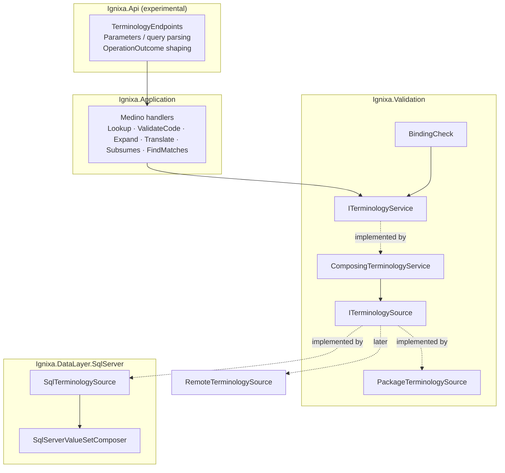

# Composable Terminology Operations — Design

**Status:** Draft for review
**Date:** 2026-10-20
**ADR:** [ADR-2610 Composable Terminology Operations](../../adr/adr-2610-composable-terminology-operations.md) (Proposed)
**Investigation:** [Composing FHIR Terminology Operations](../../features/terminology-services/investigations/composable-operations.md)

## 1. Problem

Ignixa answers terminology questions through `ITerminologyService` (`Ignixa.Validation`). Three implementations exist:

- `SqlServerTerminologyService`: imported CodeSystems, ValueSets, and ConceptMaps in SQL.
- `InMemoryTerminologyService`: package/IG content loaded through `IValueSetProvider` and `ICodeSystemProvider`.
- `HybridTerminologyService`: chooses **one** of the two for the **whole call**, based on whether the top-level canonical is imported.

This structure causes four problems:

1. **Whole-call routing loses answers.** If a ValueSet includes LOINC (SQL) and a package-only CodeSystem, one implementation answers the whole call, and neither can see both parts.
2. **Results cannot say “unknown”.** If terminology is missing, subsumption returns `not-subsumed`, translation returns `Result=false`, validation returns `IsValid=true` with a Warning, and lookup returns `Found=false`. Callers cannot tell “definitely no” from “could not determine.” Composition would combine these misleading answers.
3. **Public API gaps.** Only `$expand` (GET), `$translate` (POST), and `$subsumes` (POST) are exposed. `$lookup`, CodeSystem `$validate-code`, ValueSet `$validate-code`, and `$find-matches` are missing. `$translate` ignores `source`, `target`, and `version`. `$expand` emits `expansion.incomplete`, which is not an R4 element, and returns partial expansions where R4 requires an error.
4. **Duplicate dead code.** The handlers in `Ignixa.Application.Operations/Features/Terminology` are stale copies from #61. The live handlers are in `Ignixa.Application/Features/Experimental/Terminology`.

## 2. Decisions Already Made

| Decision | Choice |
|---|---|
| Sources | Local only: SQL and package/in-memory. Design a source seam so a remote terminology server can be added later without changing operations. |
| FHIR versions | Use a version-neutral internal model. Implement the R4/R4B wire format first. Add R5 parameter mapping as a later phase. |
| Contract evolution | Evolve `ITerminologyService` directly. A breaking change to `Ignixa.Validation` is accepted. |
| Exposure | Keep all endpoints behind `Experimental:Features:Terminology`. Graduation is a separate decision. |
| Architecture | **Approach A:** split work by code system. Per-system sources sit under one composing service, and SQL handles the whole query when it owns every part. |
| Delivery | One holistic design delivered as independently mergeable phases (§9). |

## 3. Architecture



- **`ITerminologyService`** is the operation-level contract used by validation (`BindingCheck`), transform (`ConceptMapResolverService`), and API handlers. It keeps one implementation: `ComposingTerminologyService`.
- **`ITerminologySource`** is a per-system contract for one store that owns some CodeSystems, ValueSets, and ConceptMaps. It is justified by present variation: SQL and package sources exist now, and a remote source is planned.
- **`ComposingTerminologyService`** turns each operation into calls to the sources that own the relevant systems and combines their answers. It replaces `HybridTerminologyService`, which is deleted.
- The **API boundary** parses FHIR `Parameters` and query strings and shapes `Parameters` and `OperationOutcome` responses. Composition never makes local HTTP calls to Ignixa’s own endpoints, as required by ADR-2610.

### 3.1 Source contract

```csharp
public interface ITerminologySource
{
    string Name { get; }  // diagnostics only: "sql", "package", later "remote:<host>"

    ValueTask<SourceCoverage> GetCoverageAsync(CanonicalRef canonical, CancellationToken cancellationToken);

    Task<ConceptLookup> LookupAsync(CodeRef code, LookupOptions options, CancellationToken cancellationToken);
    Task<Membership> ContainsAsync(CodeRef code, CancellationToken cancellationToken);                       // code exists in CodeSystem
    Task<Subsumption> SubsumesAsync(CodeRef a, CodeRef b, CancellationToken cancellationToken);
    Task<ConceptSet> SelectAsync(ComposeInclude include, SelectOptions options, CancellationToken cancellationToken);   // filters/concepts within one system
    Task<Membership> MatchesIncludeAsync(CodeRef code, ComposeInclude include, CancellationToken cancellationToken);  // targeted test, no enumeration
    Task<ValueSetDefinition?> ResolveValueSetAsync(CanonicalRef canonical, CancellationToken cancellationToken);
    Task<ComposeResult?> TryComposeWholeAsync(ValueSetDefinition valueSet, SelectOptions options, CancellationToken cancellationToken); // pushdown; null = cannot
    Task<IReadOnlyList<ConceptMapCandidate>> FindConceptMapsAsync(TranslateScope scope, CancellationToken cancellationToken);
}
```

`SourceCoverage` is `Authoritative`, `Partial`, or `None`. `Authoritative` means the source holds a complete CodeSystem version (for SQL, `TerminologyImportStatus.Completed`). `Partial` means it knows some concepts but cannot enumerate the system, such as package knowledge of a SNOMED subset. `None` means it does not know the canonical.

`ValueSetDefinition` is either `Composed(compose)` or `Enumerated(codes)`. SQL returns `Composed`, while the package source returns `Enumerated` because its provider holds only pre-expanded lists (§7).

Methods use small value types (`CodeRef`, `CanonicalRef`, and `ComposeInclude`) defined in `Ignixa.Validation.Abstractions.Terminology`. Construction enforces invariants: a `CodeRef` must have a non-empty system and code, and a `CanonicalRef` parses an `url|version` string once.

### 3.2 Explicit outcomes (contract change)

Each answer that can be unknown uses a three-state outcome with a reason:

```csharp
public enum Determination { True, False, Unknown }

public sealed record UnknownReason(UnknownKind Kind, string Subject, string Detail);
public enum UnknownKind { SystemNotAvailable, SystemVersionNotAvailable, ValueSetNotFound, UnsupportedFilter, NonEnumerableSystem, BudgetExceeded, SourceFailed }
```

The breaking changes to `ITerminologyService` are:

| Today | New |
|---|---|
| `ValidateCodeAsync(system, code, display, valueSetUrl)` → `TerminologyValidationResult(IsValid, Severity, Message)` | `ValidateCodeInValueSetAsync(ValidateCodeRequest)` and `ValidateCodeInCodeSystemAsync(ValidateCodeRequest)` → `ValidateCodeResult(Determination Result, string? Display, IReadOnlyList<TerminologyIssue> Issues, IReadOnlyList<UnknownReason> Unknowns)` |
| `LookupCodeAsync(...)` → `LookupResult(bool Found, …)` | `LookupAsync(LookupRequest)` → `LookupResult(Determination Found, …, UnknownReason? Unknown)` |
| `ExpandValueSetAsync` → `ExpandResult?` with `Incomplete` | `ExpandAsync(ExpandRequest)` → `ExpandOutcome`, which is either `Expanded(ExpandResult)` or `NotExpandable(IReadOnlyList<UnknownReason>)`. `Incomplete` is removed. |
| `SubsumesAsync` → `SubsumesResult(string Outcome)` | `SubsumesOutcome`, which is either `Related(SubsumptionRelation)` or `Undetermined(UnknownReason)`. `SubsumptionRelation` is an enum: `Equivalent`, `Subsumes`, `SubsumedBy`, `NotSubsumed`. |
| `TranslateCodeAsync` → `TranslateResult(bool Result, …)` | `TranslateAsync(TranslateRequest)` → `TranslateResult(IReadOnlyList<TranslateMatch> Matches, IReadOnlyList<UnknownReason> Unknowns)`. FHIR `result` is derived from the matches, not stored separately. |
| `ValidateBindingAsync(...)` → `BindingValidationResult` | Kept for `BindingCheck`, but it now maps strength onto `ValidateCodeResult`. `Unknown` maps to the existing “unable to verify” Warning behaviour. This preserves validator output exactly (guarded by existing tests). |

Severity mapping (`Determination` → `IssueSeverity`) is owned by the validator and API boundary, not by sources. Sources report facts; boundaries decide policy.

## 4. Composition Rules

### 4.1 Routing

`SourceRouter` is an internal helper of the composer. It chooses sources for each canonical by trying them in registration order: SQL, then package, then later remote. The first `Authoritative` source wins. If none is authoritative, the router uses `Partial` sources and adds `NonEnumerableSystem` to `Unknowns` because a negative answer cannot be authoritative. If no source has coverage, the answer is `Unknown(SystemNotAvailable)`. Coverage lookups are memoized for the lifetime of one request, not across requests, because imports change coverage.

### 4.2 Operation decompositions

| Operation | Decomposition |
|---|---|
| CodeSystem `$lookup` | route(system) → `LookupAsync`. Unknown system: `Unknown`, and the API returns 404 with OperationOutcome `not-found`. |
| CodeSystem `$validate-code` | route(system) → `ContainsAsync`. If true and `display` is supplied, call `LookupAsync` to compare display and designations, then add a display issue (warning by default; error when `lenient-display-validation=false`, R5 only, later phase). |
| ValueSet `$validate-code` | Resolve the ValueSet. For `Enumerated`, test membership directly. For `Composed`, evaluate `compose` **targeted**. For each include whose system matches the code, call `MatchesIncludeAsync` on the routed source. Recursively evaluate `valueSet` imports. Apply excludes the same way. Optionally run the display check as above. **Do not expand the whole ValueSet.** If any relevant include is Unknown and no include is True, the result is `Unknown` with all reasons. If an include is True, matching excludes are evaluated: True → `False`; Unknown → `Unknown`; False → `True`. |
| `Coding`/`CodeableConcept` inputs | Validate each coding. A CodeableConcept is True if any coding is True; otherwise Unknown if any is Unknown; otherwise False. Issues are reported per coding. |
| ValueSet `$expand` | Resolve ValueSet. If one source is authoritative for every include and import, call `TryComposeWholeAsync`; SQL uses `SqlServerValueSetComposer`. Otherwise, call `SelectAsync` per include on the routed source, recurse through imports, then union, intersect, and exclude in the composer. **R4 rule:** any `UnknownReason` produces `NotExpandable`, and the API returns 422 with OperationOutcome `not-supported`/`not-found`. The response never has partial contents. |
| `$expand` filter/paging | `filter`, `count`, and `offset` are applied after composition. Pushdown passes them to SQL. `total` is always exact, or omitted if counting would exceed budget. |
| CodeSystem `$subsumes` | route(system) → `SubsumesAsync`. If either code is unknown, return `Undetermined`, and the API returns 400 with OperationOutcome `invalid`/`not-found`. The response never says `not-subsumed`. |
| ConceptMap `$translate` | `FindConceptMapsAsync(scope)` with url, conceptMapVersion, source/target ValueSet scope, system+version, targetsystem, and reverse, all enforced. Then evaluate mapping groups. `dependsOn` is supported only for exact match; unsupported dependencies produce `UnknownReason`, not silent matches. |
| CodeSystem `$find-matches` | Phase 6. The R4 operation is preliminary. Support only `exact=true` with property equality via `SelectAsync` and a synthetic include filter. Other modes return 422 `not-supported`. |
| `$closure` | Out of scope (§10). |

### 4.3 Recursion, cycles, and budgets

- ValueSet imports are evaluated depth-first with a visited set keyed by `CanonicalRef`. A cycle is a definition error that produces 422 `invalid` and an `UnknownReason`; it is not an infinite loop.
- `TerminologyBudget` is a per-request value: max import depth (default 10), max enumerated concepts for in-composer expansion (default 100,000), and the caller's `CancellationToken`. Exceeding it produces `UnknownReason(BudgetExceeded)`. Defaults come from `Experimental:Features:Terminology` options.
- Sources run sequentially within one request. Includes are independent, but SQL sources share a connection pool, and parallel fan-out is unmeasured. Adding parallelism later is a local change in the composer.

### 4.4 Failure semantics

- A source exception is **not** turned into Unknown. Expected missing data is Unknown; unexpected failures, such as SQL errors, propagate through the existing error pipeline as 500. This follows the repository rule against success-shaped fallbacks. The `SourceFailed` kind exists only for the future remote source, where an expected network failure or timeout is a boundary condition.
- Every response with Unknowns lists them in an OperationOutcome issue (`not-found`/`not-supported`/`too-costly`) so degradation is visible.

## 5. API Surface (experimental, R4/R4B wire format)

All routes have tenant-agnostic and `/tenant/{tenantId}` forms, as today.

| Route | Methods | Notes |
|---|---|---|
| `CodeSystem/$lookup` | GET, POST | `system`, `code`, `version`, `coding`, `property`, `displayLanguage` (passed through; language selection uses designations when present) |
| `CodeSystem/{id}/$lookup` | GET, POST | instance-level, which binds `system` |
| `CodeSystem/$validate-code`, `CodeSystem/{id}/$validate-code` | GET, POST | `url`, `code`, `version`, `display`, `coding`, `codeableConcept` |
| `ValueSet/$validate-code`, `ValueSet/{id}/$validate-code` | GET, POST | `url`, `valueSetVersion`, `code`, `system`, `systemVersion`, `display`, `coding`, `codeableConcept`, `abstract` |
| `ValueSet/$expand`, `ValueSet/{id}/$expand` | GET, POST | existing params plus `valueSetVersion`; POST accepts `valueSet` (inline) |
| `ConceptMap/$translate`, `ConceptMap/{id}/$translate` | GET, POST | adds GET; enforces `source`/`target`/`version`; `coding` and `codeableConcept` inputs |
| `CodeSystem/$subsumes`, `CodeSystem/{id}/$subsumes` | GET, POST | adds GET and `codingA`/`codingB` |
| `CodeSystem/$find-matches` | GET, POST | Phase 6, exact mode only |

- POST bodies are FHIR `Parameters` resources. The current ad-hoc JSON DTOs (`TranslateRequestDto`, `SubsumesRequestDto`) are **removed**. This is acceptable because the feature is experimental, and it is called out in release notes.
- A single `TerminologyParametersReader` handles GET query parameters and POST `Parameters` uniformly, producing the version-neutral request records. R5 aliases (`sourceCode`, `targetCode`, …) are added there in Phase 7.
- Response shaping produces `Parameters` with R4 output names (`result`, `message`, `display`; `match.equivalence` in R4 and `match.relationship` in R5 later).
- Error status mapping: 400 for malformed or missing parameters; 404 for an unknown CodeSystem/ValueSet/ConceptMap on lookup or instance routes; 422 for `NotExpandable` or an undetermined subsumption caused by unsupported content. In `$validate-code`, an Unknown result returns **200** with `result=false` and a message plus `issues`. This matches R4 `$validate-code`, which reports inability through `result=false` and a message rather than an HTTP error.
- Tenant ID is currently unused because terminology content is shared across tenants. Requests still carry tenant ID so routing can use it if tenant-scoped content arrives. Partition 0 is never exposed.

## 6. Version-Neutral Model and R5

Internal request and result records use neutral names (`SourceCode`, `TargetSystem`, `Relationship`). `TranslateMatch.Relationship` is an enum mapped from R4 `equivalence` codes at the SQL source boundary. R4 output maps back to `equivalence`. Phase 7 adds R5 output (`relationship`, `issues` on `$validate-code`, `lenient-display-validation`) through the reader and writer, without touching the composer.

STU3 is not supported by these endpoints. The STU3 `$compose` naming difference is noted and not implemented.

## 7. Package Source

`PackageTerminologySource` wraps the providers currently used by `InMemoryTerminologyService`. Their present capabilities are deliberately narrow, and the source must not overstate them:

- `ICodeSystemProvider` exposes only `ContainsCode(system, code) → bool?` and `GetDisplay`. It provides no hierarchy, content mode, or properties.
- `IValueSetProvider` exposes **pre-expanded** flat code lists (`GetCodes`) and has no `compose` definition.

Consequences:

- CodeSystem coverage: `ContainsCode` returns `true` or `false` → `Authoritative` for that system. It returns `null` → `None`. Systems in `NonEnumerableSystems` (SNOMED, LOINC, UCUM, …) are always at most `Partial`, so a package miss for them is `Unknown(NonEnumerableSystem)`. This preserves today's validator behaviour.
- `ResolveValueSetAsync` returns an **enumerated** `ValueSetDefinition`, which is a code list rather than a compose. The composer evaluates membership directly, and `$expand` can page over it.
- `SelectAsync` over a package CodeSystem supports only explicit `concept` lists. Every filter (`is-a`, `=`, `regex`, …) returns `UnknownReason(UnsupportedFilter)`.
- `SubsumesAsync` returns `Undetermined(UnsupportedFilter)` instead of today's unconditional `not-subsumed`. Adding hierarchy to `ICodeSystemProvider` is a separate, additive change and is out of scope here.
- `InMemoryTerminologyService` remains as the **standalone** `ITerminologyService` used by `PackageBackedValidator` and `StructureDefinitionSchemaResolver`, which run without a server. It becomes a thin `ComposingTerminologyService` over one `PackageTerminologySource`, so there is one composition algorithm.

## 8. SQL Source

`SqlTerminologySource` adapts `SqlServerTerminologyService`, which is renamed or absorbed. `SqlServerValueSetComposer` is retained as the pushdown engine.

- Coverage comes from `ITerminologyImportStatusProvider`.
- `TryComposeWholeAsync` calls `SqlServerValueSetComposer`. Its existing `_externalSystems`, `_missingValueSets`, `_unknownSystemVersions`, and `_unsupportedFilters` tracking becomes `UnknownReason`s, so pushdown keeps the same strict semantics.
- `MatchesIncludeAsync` is a new targeted SQL query that tests one code against one include’s filters without materialising the include. This is the main performance change for `$validate-code`.
- `FindConceptMapsAsync` and mapping evaluation fix the ignored `source`, `target`, and `version` parameters.
- No changes are made to `MergeResources` stored procedures or TVPs. New queries use existing `Term*` tables. Schema changes are not expected; if `MatchesIncludeAsync` needs an index, the change is a separate migration reviewed on its own.

## 9. Phased Delivery

Each phase builds, passes tests, and can merge on its own.

| Phase | Scope | Key tests |
|---|---|---|
| **0. Groundwork** | Delete stale `Application.Operations` terminology handlers. Add value types (`CodeRef`, `CanonicalRef`, `Determination`, `UnknownReason`). Add `ITerminologySource` and `SourceRouter`. | Invariant tests on value types; router coverage precedence |
| **1. Contract break + composer skeleton** | New `ITerminologyService` shape. Add `ComposingTerminologyService` with lookup, CodeSystem validate-code, and subsumes. Adapt `SqlTerminologySource` and `PackageTerminologySource`. Delete `HybridTerminologyService`. Port `BindingCheck`, `ConceptMapResolverService`, and the existing handlers. | All existing validation and binding tests unchanged (guards); unknown-vs-false subsumption regression; mixed-source lookup |
| **2. ValueSet `$validate-code` (targeted)** | Compose evaluation with `MatchesIncludeAsync`, imports, excludes, cycle and budget handling, display check, and Coding/CodeableConcept. | **Mixed-source ValueSet regression** (fails on base); cycle; exclude precedence; unknown system → result=false + message |
| **3. Public lookup + validate-code endpoints; Parameters reader/writer** | GET/POST type and instance routes; remove JSON DTOs; OperationOutcome mapping. | Endpoint tests per route, tenant and agnostic; malformed Parameters → 400 |
| **4. `$expand` R4 correctness** | Pushdown-or-compose; `NotExpandable` → 422; remove `Incomplete`; POST with inline `valueSet`; `valueSetVersion`. | Regression: unresolved system returns error instead of partial expansion; nested imports; paging/total |
| **5. `$translate` correctness** | Enforce source, target, and version; Coding/CodeableConcept; equivalence model; GET route. | Regressions per ignored parameter (fail on base); reverse; unmatched |
| **6. `$find-matches` (exact)** | Exact property matching only. | Exact match; non-exact → 422 |
| **7. R5 wire mapping** | Reader/writer aliases and outputs. | Round-trip per operation in R5 |

Phases 2–6 depend on 1 and are otherwise independent. Phase 7 depends on 3–5.

## 10. Out of Scope

- `$closure` is a stateful, system-level operation and needs its own design. Hierarchy primitives from `SubsumesAsync` and `SelectAsync` are reusable later.
- A remote terminology source is enabled by the seam but not implemented.
- `$batch-validate-code` from FHIRsmith is non-core; batching is an optimization to reconsider after measurement.
- Graduation from experimental and CapabilityStatement advertising are excluded.
- STU3 endpoints are excluded.
- A generic operation-graph or orchestrator is rejected by ADR-2610.
- Cross-request coverage caching is deferred until measurement shows it is needed.

## 11. Risks

| Risk | Mitigation |
|---|---|
| Breaking `Ignixa.Validation` affects SDK consumers | Single-phase contract change (Phase 1) with release notes; `ValidateBindingAsync` behaviour pinned by existing guards |
| Validator behaviour drifts when Unknown replaces success-shaped Warnings | Phase 1 maps Unknown to the exact current Warning text; snapshot guards on `BindingCheck` |
| In-composer expansion of large non-pushdown ValueSets | Budget cap, then `BudgetExceeded` → 422 `too-costly`; pushdown whenever one source owns everything |
| `MatchesIncludeAsync` SQL performance on SNOMED-scale `is-a` | Uses existing ancestry walk over `ParentConceptId`; measure on the imported SNOMED fixture before merging Phase 2 |
| Removing ad-hoc JSON DTOs breaks experimental callers | Experimental flag; documented in `docs/site` terminology page |

## 12. Documentation

- Update `docs/site/docs/` terminology pages per phase with routes, parameters, and error semantics.
- After Phase 4 merges, move ADR-2610 from Proposed to Accepted using the accept-adr workflow.
- Update the terminology feature readme index to link this spec.
